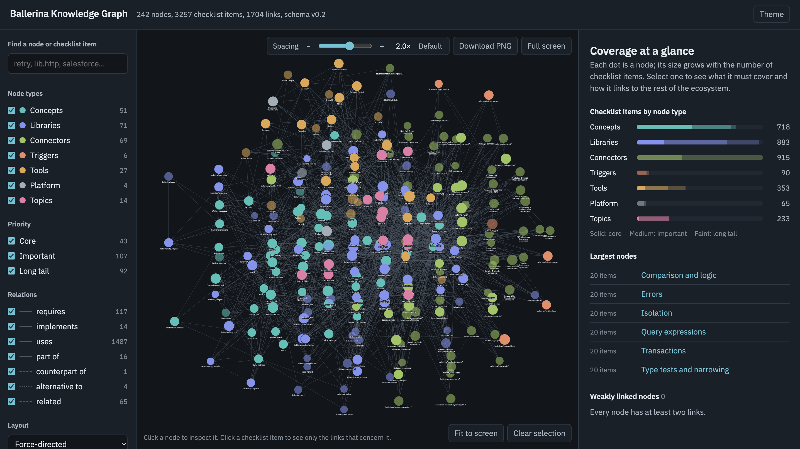

# Ballerina Ecosystem Knowledge Graph

A knowledge graph of the Ballerina language and its ecosystem that drives supervised
fine-tuning (SFT) dataset generation. Each node lists what the training data must cover
(`must_cover` items), and typed edges link related nodes. Every `must_cover` item becomes one or
more training samples, so a feature missing from the graph is never trained on.

The nodes are built from:
- the [Ballerina Language Specification 2024R1](https://ballerina.io/spec/lang/2024R1/)
  (language concepts and the lang library)
- the module READMEs and API sources in the
  [ballerina-platform](https://github.com/orgs/ballerina-platform/repositories) GitHub org
- [Ballerina by Example](https://ballerina.io/learn/by-example/)
- [Ballerina Central](https://central.ballerina.io/) (every published package, its README and API docs)
- the [Learn](https://ballerina.io/learn/) docs (tools, packages, guides)
- the Swan Lake release notes (runtime, distributions and changes after spec 2024R1)

Every node cites the pages it was built from in its `sources`.

**View the graph:** https://sajith-jeewantha.github.io/ballerina-ecosystem/ballerina-graph/build/viewer.html
(raw data: [graph.json](https://sajith-jeewantha.github.io/ballerina-ecosystem/ballerina-graph/build/graph.json))



**How it works:** [Ballerina Graph Architecture](https://sajith-jeewantha.github.io/ballerina-ecosystem/docs/pages/Ballerina%20Graph%20Architecture.html)
explains the architecture, the node format, validation, the viewer and how the graph was built
(source: [docs/pages/](docs/pages/Ballerina%20Graph%20Architecture.html)).

## Repository layout

```
.
├── README.md                 # this file
├── prompt.md                 # task brief used to build the spec-derived nodes
├── docs/images/              # images used in this README
├── docs/pages/               # architecture explainer page
└── ballerina-graph/          # Python package: schema, loader, CLI and node data
    ├── ballerina_graph/      # Pydantic models, loader/validator, export and viewer
    ├── nodes/                # one YAML file per node (<id>.yaml)
    ├── schema/               # node.schema.json for editor validation
    ├── pyproject.toml
    └── README.md             # package README and harness API
```

## Setup

Requires Python 3.10 or later.

```bash
cd ballerina-graph
python -m venv .venv
source .venv/bin/activate
pip install -e .
```

## Commands

Run these from `ballerina-graph/`:

| Command | What it does |
|---|---|
| `python -m ballerina_graph validate nodes/` | Runs all validation rules. Errors fail the run; warnings are printed. |
| `python -m ballerina_graph stats nodes/` | Prints counts by node type, priority and edge relation. |
| `python -m ballerina_graph export nodes/ --out build/` | Writes `build/graph.json` and regenerates `schema/node.schema.json`. |
| `python -m ballerina_graph view nodes/` | Writes `build/viewer.html`, a self-contained graph viewer you can open in any browser. |
| `python -m ballerina_graph serve nodes/ [--port 8000]` | Serves the viewer at http://127.0.0.1:8000/ with title editing turned on. |

`build/` holds the published graph: `build/graph.json` (the full graph) and
`build/viewer.html` (the interactive viewer). Re-run `export` and `view` after changing nodes
so they stay in sync. To get an image of the graph, use the viewer's **Download PNG** button.

### Using the viewer

- **Spacing:** the Spacing control above the graph changes the gap between nodes (`−`/`+` or
  the slider, 0.5× to 3×). **Default** resets it to 2.0×. Your last setting is remembered in
  the browser.
- **Download PNG:** saves the whole graph (every node that passes the current filters, not just
  the part on screen) as `ballerina-graph.png`, at a size where labels stay readable.
- **Full screen:** **Full screen** shows only the graph across the whole screen. Click
  **Exit full screen** or press Esc to return.
- **Editing titles:** run `serve`, open a node and click **Edit title**. Saving rewrites only
  the `title:` line in that node's YAML file. Enter saves and Esc cancels. Editing is not
  available on GitHub Pages or in `build/viewer.html`, which have no server to write files.
  After editing, re-run `view` and `export` to update `build/`.

GitHub Pages serves the `main` branch, so pushing updated `build/` files to `main` updates the
hosted viewer.

## Node format

Each node is a YAML file in `ballerina-graph/nodes/` named after its id, for example
`concept.arrays_tuples.yaml`:

```yaml
schema_version: "0.2"
id: concept.arrays_tuples
type: concept            # concept | library | connector | trigger | tool | platform | topic
title: Arrays and tuples
summary: ...
priority: core           # core | important | long_tail
status: draft
sources:
  - {url: "https://ballerina.io/spec/lang/2024R1/#section_5.4.1", kind: spec, note: "5.4.1 Lists"}
must_cover:
  - id: array_basics
    text: Declare arrays with `T[]`, build them with list constructors ...
    difficulty: [beginner]
out_of_scope:
  - "List binding patterns and destructuring (concept.binding_patterns)"
edges:
  - {to: concept.basic_types, rel: requires}
  - {to: concept.langlib, rel: uses, via: [array_langlib], target_items: [lang_array]}
```

Node types and id prefixes:

| Type | Prefix | Covers |
|---|---|---|
| `concept` | `concept.` | Language features defined by the spec, including the lang library |
| `library` | `lib.` | `ballerina/*` packages: the standard library and the lang library, such as `ballerina/http` |
| `connector` | `connector.` | `ballerinax/*` packages that connect to an external system: SaaS APIs, databases, message brokers, AI services |
| `trigger` | `trigger.` | `ballerinax/trigger.*` event listeners for external systems, such as GitHub or Slack webhooks |
| `tool` | `tool.` | The `bal` CLI, its subcommands, build and config files, IDEs and CI/CD |
| `platform` | `platform.` | The runtime, Swan Lake distributions, releases and the specifications |
| `topic` | `topic.` | Cross-cutting guidance such as idioms and best practices |

`library`, `connector` and `trigger` nodes are package nodes and must list the Central packages
they cover in `modules`.

### Authoring rules

- Each node has 5 to 20 `must_cover` items. Each item starts with a verb and names real syntax.
- Items must come from the source. For spec nodes, cite spec anchors with `kind: spec`.
- `requires` edges must not form a cycle.
- `uses` and `implements` edges should be scoped with `via` (source items) and, where useful,
  `target_items`.
- Symmetric relations (`related`, `alternative_to`, `counterpart_of`) are declared once, on one
  of the two nodes.
- Edges must not point to missing nodes, and every node should have at least one edge in or out.

## Current status

All nodes are `status: draft` and await domain-expert review, except `lib.regex`, `lib.xmldata`
and `lib.yaml`, which are `status: deprecated` and name their replacements in `replaced_by`.

| | Count |
|---|---|
| Nodes | 242: 51 concept, 71 library, 69 connector, 6 trigger, 27 tool, 4 platform, 14 topic |
| `must_cover` items | 3,257 |
| Edges | 1,704 (uses 1,487, requires 117, related 65, part_of 16, implements 14, alternative_to 4, counterpart_of 1) |
| Priority | core 43, important 107, long_tail 92 |

`validate` reports `OK: 242 nodes, 3257 items, 1704 edges, 0 warning(s)`.

Coverage of the sources:

| Source | Covered |
|---|---|
| Ballerina Central packages (`ballerina/*` and `ballerinax/*`) | 856 of 856: each package is listed in a node's `modules` and named in at least one item |
| Ballerina by Example programs | 592 of 592 cited as sources |
| Learn pages | 77 of 77 cited as sources |

What the nodes cover:

| Type | Nodes | Items | Scope |
|---|---|---|---|
| `concept` | 51 | 718 | Language features from spec 2024R1 chapters 2 to 10 (types, expressions, statements, concurrency, XML, queries, transactions...), plus natural expressions added in Update 13 |
| `library` | 71 | 883 | The lang library (`langlib` and the `ballerina/lang.*` modules); the `ballerina/*` standard library (HTTP, GraphQL, gRPC, WebSocket, SQL, persist, IO, data.*, auth, JWT, OAuth2, crypto, log, test, observe, AI, MCP, workflow, messaging, file formats...) and the deprecated `regex`, `xmldata` and `yaml` packages |
| `connector` | 69 | 915 | Every `ballerinax/*` connector: databases and brokers, AI model providers and vector stores, Salesforce, HubSpot, SAP, Workday, Microsoft 365, Azure, AWS, Google, healthcare (FHIR, HL7v2), B2B (EDI, AS2), and the long tail grouped by business area |
| `trigger` | 6 | 90 | `ballerinax/trigger.*` listeners: GitHub, Google, HubSpot, Shopify, Slack and others |
| `tool` | 27 | 353 | `bal` and its subcommands, packages, `Ballerina.toml`, `Dependencies.toml`, `Config.toml`, Ballerina Central, testing, code generators, Code to Cloud, GraalVM, debugger, profiler, VS Code, IntelliJ, CI/CD |
| `platform` | 4 | 65 | The runtime, Swan Lake distributions, the release history and the specifications |
| `topic` | 14 | 233 | Cross-cutting guides: REST APIs, best practices, data mapping, integration patterns, AI agents, security, observability, connectors, event-driven, resiliency, data services, file integration, deployment, healthcare |

Library and connector titles are the package names you import (`ballerina/http`,
`ballerinax/mysql`). Connector nodes that group many small generated packages are titled after
their business area.
